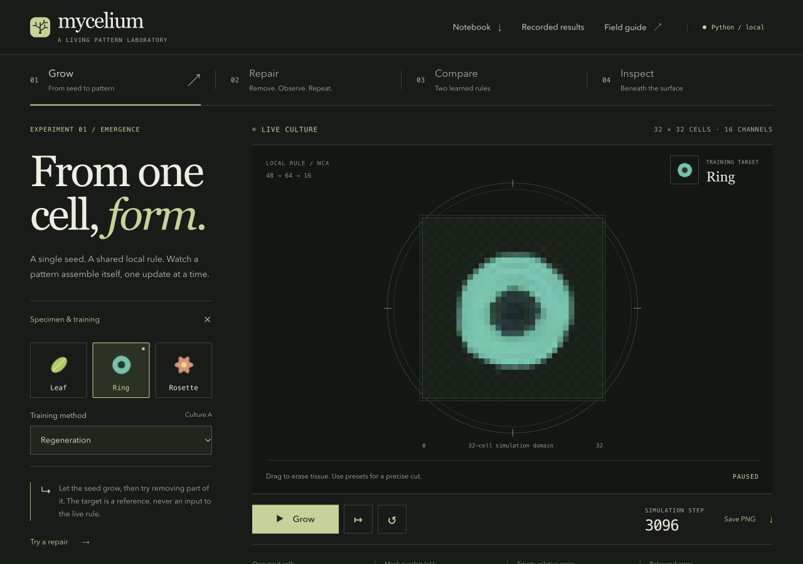
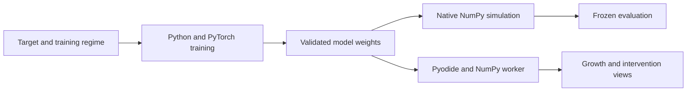

# Mycelium

A neural cellular automata laboratory in Python. Train tiny local rules, grow patterns from a single cell, and investigate what growth, persistence, and damage training actually change.

[](pyproject.toml)
[](LICENSE)
[](https://dhanushkrishna4.github.io/Mycelium/)

[Live demo](https://dhanushkrishna4.github.io/Mycelium/) · [Documentation](#documentation) · [Validation](#validation-and-results) · [License](#license)



## Highlights

- **Grow and repair:** run five trained models across ring, leaf, and rosette targets; erase tissue, create persistent lesions, plant seeds, or apply bounded seeded noise.
- **Compare training regimes:** replay ring growth, persistence, and regeneration models with identical random update schedules and intervention events.
- **Inspect hidden state:** view alpha, numbered hidden channels, and update magnitude; fork an experiment into control and perturbed branches and measure divergence.
- **Keep experiments local:** export/import experiments, validated model JSON, measurements, and visible PNGs. Live simulation runs in a persistent Python/NumPy worker through Pyodide, without an inference API or backend.

## How it works



A 32×32 grid holds 16 float32 channels: premultiplied RGB/alpha and twelve hidden channels. Each cell perceives its immediate neighborhood through identity and Sobel filters; one shared 48→64→16 network proposes updates. Cells fire independently with default probability 0.5. Pre- and post-update living masks enforce a 3×3 alpha neighborhood above 0.1.

Inference has no coordinates, target lookups, global pooling, or corrective target blending. Internal states are never clipped; numerical failure stops execution. The transition, training loop, replay, and experiment tooling are implemented in this repository. NumPy provides runtime numerical operations; PyTorch provides native training/autograd and is not imported by the runtime. Pillow supports artwork and training. The browser interface has no JavaScript framework or npm dependencies.

## Run locally

Use **Python 3.12** and **Node.js 20+**. Start in the repository root:

```sh
python3.12 -m venv .venv
.venv/bin/python -m pip install -e '.[train,test]'
npm run runtime
npm run build
.venv/bin/python scripts/serve.py
```

Open **http://127.0.0.1:8732/Mycelium/**. The server only serves static files. Runtime acquisition downloads six pinned, hash-verified Pyodide/NumPy assets; subsequent builds can run offline. Builds use included trained artifacts and never retrain. For native simulation alone, install with `pip install -e .`.

To measure your device, train one bounded run, and export its best checkpoint:

```sh
.venv/bin/python -m mycelium_nca.cli pilot --device cpu --output-dir runs/my-pilot
.venv/bin/python -m mycelium_nca.cli train --config configs/train-default.json --target ring --regime regeneration --output-dir runs/my-ring
.venv/bin/python -m mycelium_nca.cli export runs/my-ring/checkpoints/best.pt models/my-ring.json
```

The default cap is 2,500 optimizer updates. Use `--seed` for independent training replications and `--updates`, `--wall-seconds`, and `--memory-mb` for explicit budgets. Budget exhaustion does not establish convergence. Resume, custom PNG training, and sequential release reproduction are documented in [the training protocol](docs/TRAINING.md). Native checkpoints must be trusted local files; browser imports accept only validated data-only JSON. If an environment ignores the editable install, prefix source commands with `PYTHONPATH=src`.

## Validation and results

These are **recorded results**, not tests rerun for this README update. The [frozen evaluation](configs/evaluation-v1.json) predates training; checkpoint selection used a separate validation suite. Quality requires foreground/background-balanced error relative to the empty baseline ≤0.35 and alpha-mask IoU ≥0.65.

| Model | Growth at 256 | Persistence through 1024 | Repair |
|---|---:|---:|---:|
| Ring · growth only | 0/8 | 0/4 | 0/9 |
| Ring · persistence | 8/8 | 4/4 | 9/9 |
| Ring · regeneration | 8/8 | 4/4 | 9/9 |
| Leaf · regeneration | 8/8 | 0/4 | 9/9 |
| Rosette · regeneration | 8/8 | 0/4 | 9/9 |

Repair trials require an acceptable mature start, ≥8% occupied-cell removal, and three consecutive acceptable post-damage samples. One ring-persistence recovery later deteriorated: 8/9 retained recovery through the full horizon, versus 9/9 for ring regeneration. [Raw reports](reports/summary.json) preserve unsuccessful trials.

Five sequential release runs on an Apple M3 with 8 GB RAM took **30.5 minutes**, with maximum measured process RSS **633.25 MiB**. CPU was faster than MPS in the recorded pilot. The original transparent-center ring pilot collapsed to extinction; its failed runs remain in [training provenance](reports/training/summary.json).

Recorded verification includes **41 native tests**, **3 JavaScript tests**, browser numerical parity, imports/exports, and production asset checks. [Browser diagnostics](reports/browser-diagnostics.json) record a configuration-specific 418 steps/s simulation benchmark excluding rendering/startup; this is not a frame-rate promise.

```sh
.venv/bin/python -m pytest -q
npm run check:web
.venv/bin/python -m mycelium_nca.cli evaluate
npm run build
.venv/bin/python scripts/verify_build.py
```

Evaluation uses supplied artifacts without retraining. See the [browser verification record](reports/browser-verification.json) and [redesign verification](docs/redesign/README.md).

## Scope and limitations

- Results are single-training-run case studies. Rollout seeds are not independent training replications; reconstruction of known targets is not unseen-image generalization.
- Leaf and rosette fail long persistence; growth-only ring fails the fixed 256-step growth gate. An exploratory growth-only browser run also stopped with numerical failure near step 1396.
- Total erasure remains extinct until explicit reseeding. Large cuts can fail; persistent lesions force cells to zero and do not imply obstacle understanding. No stability beyond measured horizons is promised.
- New PNG targets require local training. The browser cannot learn an imported image.
- Replay is scoped to the pinned NumPy/runtime and PCG64 sampling contract. Backend differences can eventually change threshold dynamics. Histories are bounded; exports label partial retained histories.
- Safari, Firefox, physical touch, full screen-reader use, and real background-tab pause remain unverified. Responsive Chromium checks do not establish physical-device coverage.

## Documentation

| Guide | Contents |
| --- | --- |
| [Transition and schemas](docs/transition.md) | Cell update rule and file formats |
| [Training](docs/TRAINING.md) | Checkpoints, budgets, and reproducibility |
| [Evaluation](docs/evaluation.md) | Frozen quality gates and measured limitations |
| [Browser architecture](docs/browser.md) | Runtime, state, and replay |
| [Interface review](docs/redesign/README.md) | Screenshots and verification records |
| [Deployment](docs/deployment.md) | Static builds and GitHub Pages |

Research credit: independent implementation based on Mordvintsev, Randazzo, Niklasson, and Levin, [*Growing Neural Cellular Automata*, Distill (2020)](https://distill.pub/2020/growing-ca/) and their [reference notebook](https://github.com/google-research/self-organising-systems/blob/master/notebooks/growing_ca.ipynb). This project adds its own implementation, targets, experiments, replay format, and investigative interface; it makes no claim of biological realism, guaranteed repair, general intelligence, or research superiority.

## Deployment

The [GitHub Actions workflow](.github/workflows/pages.yml) tests and builds on pull requests. Successful pushes to `main` deploy the static bundle to GitHub Pages; manual dispatch on `main` can deploy when requested. The case-sensitive `/Mycelium/` subpath is supported. [Recorded hosted verification](reports/deployment-verification.json) identifies the tested commit and asset checks; it is a historical verification record, not continuous monitoring.

## License

Original code, artwork, and weights are released under the [MIT License](LICENSE). Dependencies retain their respective licenses; see [third-party attribution](THIRD_PARTY.md).
