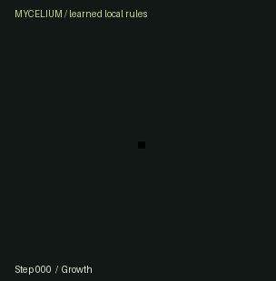

# Mycelium

Tiny neural cellular automata, trained locally and running live in your browser. A single cell grows a pattern; erase its tissue and watch the learned local rule attempt to rebuild it. Explore what growth, persistence, and damage training actually change.

[Open Mycelium](https://dhanushkrishna4.github.io/Mycelium/) · [Source repository](https://github.com/DhanushKrishna4/Mycelium)

Published on GitHub Pages and verified on 2026-10-13: live Python growth, damage/recovery, extinction, explicit reseeding, and numerical parity. [Deployment verification](reports/deployment-verification.json) records the tested commit and hosted asset checks.



This animation records a real rollout. The application performs live Python/NumPy simulation inside a persistent Pyodide worker, with no inference API or backend. The five included models were trained sequentially on an Apple M3 with 8 GB memory.

## Run locally

Use Python 3.12 and Node.js 20 or newer. No JavaScript framework or npm dependencies are required.

```sh
python3.12 -m venv .venv
.venv/bin/python -m pip install -e '.[train,test]'
npm run runtime
npm run build
.venv/bin/python scripts/serve.py
```

Open **http://127.0.0.1:8732/Mycelium/**. The static server performs no computation. `npm run runtime` downloads six pinned, hash-verified Pyodide/NumPy assets; later builds are offline. `npm run build` uses the included trained JSON artifacts and never retrains. Runtime-only Python installation is `pip install -e .`; importing it does not import PyTorch. `requirements-lock.txt` records the complete measured native environment; the smaller optional dependencies in `pyproject.toml` are pinned too.

## The laboratory

- **Grow:** choose ring, leaf, or rosette; pause, step, restart, or vary playback speed. The thumbnail is the training target, separate from live output.
- **Repair:** erase all 16 channels, paint a persistent lesion, plant an explicit seed, or add bounded seeded noise. Total erasure remains extinct. Preset buttons support keyboard operation.
- **Compare:** run two ring training regimes with identical random update schedules and intervention events.
- **Inspect:** view alpha, a numbered hidden channel, or update magnitude. Fork the complete current state into control and perturbed branches; inspect visible and hidden difference maps and their divergence over time.

The notebook exports/imports complete experiments, supported data-only model JSON, measurements, and visible PNGs. A new PNG target must be trained locally; the website cannot learn a new image merely by importing it. Advanced controls include worker recreation, native-to-browser numerical parity, and an actual local throughput benchmark.

## What the rule knows

The grid is 32×32 with 16 float32 channels: premultiplied RGB/alpha plus twelve hidden channels. Each cell sees its own state and identity/Sobel perception of its immediate neighbors. One shared 48→64→16 network proposes an update; each cell fires independently with default probability 0.5. Pre- and post-update living masks enforce a 3×3 alpha neighborhood above 0.1.

There are no coordinates, target lookups, global pooling, or corrective target blending inside inference. The seed has zero RGB and ones in alpha/hidden channels at cell (16,16). Internal states are never clipped; excessive/nonfinite states stop execution. See [the exact transition and file schemas](docs/transition.md).

## Recorded results

Frozen suite [configuration](configs/evaluation-v1.json), [all raw reports](reports/summary.json), CSVs, SVG plots, model hashes, environments, and training logs are included. Quality requires foreground/background-balanced error relative to the empty baseline ≤0.35 and alpha-mask IoU ≥0.65. The config was fixed before training. Checkpoints were selected using a separate validation suite.

| Model | Growth at 256 | Persistence through 1024 | Repair | Selected update |
|---|---:|---:|---:|---:|
| Ring · growth only | 0/8 | 0/4 | 0/9 | 2400 |
| Ring · persistence | 8/8 | 4/4 | 9/9 | 2200 |
| Ring · regeneration | 8/8 | 4/4 | 9/9 | 2400 |
| Leaf · regeneration | 8/8 | 0/4 | 9/9 | 2400 |
| Rosette · regeneration | 8/8 | 0/4 | 9/9 | 2400 |

Repair trials use held-out rectangles, slits, and edge cuts over three continuations. Success requires an acceptable mature start, ≥8% actual occupied-cell removal, and three consecutive acceptable samples after damage. One ring-persistence recovery subsequently deteriorated; 8/9 retained recovery through the complete horizon, versus 9/9 for ring regeneration. These are **single-training-run case studies**. Multiple rollout seeds are not independent training replications. Reconstruction concerns known training targets, not generalization to unseen images.

The leaf and rosette fail the long persistence gate. The growth-only ring does not pass the fixed 256-step growth gate, despite its training objective improving at shorter unrolls. All models remain empty after total erasure; large cuts can fail. Persistent lesions constrain cells to zero and do not imply understanding of walls. Stress outcomes, including successes and failures, remain in every raw report. No gallery stability beyond the measured horizons is promised.

## Measured cost

Each release run used 2,500 optimizer updates, batch 4, a 128-state pool where applicable, 48–64-step unrolls, Adam, the same initialization, and per-parameter gradient normalization. Five sequential runs took **1,832.34 seconds (30.5 minutes)** in total, with a maximum measured process RSS of **633.25 MiB**. Native checkpoints contain optimizer, scheduler, pool, counters, and random states; only the last two plus best are retained locally.

The 50-update pilots included unrolls up to 96. CPU median update: **0.163 s**, peak RSS **725.97 MiB**. MPS median: **0.344 s**, peak RSS **442.5 MiB**, driver memory **243.09 MiB**. CPU was selected because it was faster for this workload. The initial transparent-center ring pilot collapsed to extinction; that failed artwork and both runs are preserved in [training provenance](reports/training/summary.json). The released ring uses a dark opaque core.

The recorded Chromium browser benchmark measured **418 steps/s** for one 32×32 model over 128 steps, including worker chunk yields and excluding rendering/startup. This is one measurement on this machine, not a frame-rate promise. The default playback is 60 steps/s. [Browser diagnostics](reports/browser-diagnostics.json) include version, checkpoint hash, parity errors, and benchmark conditions.

Verification includes **41 native tests**, **3 JavaScript tests**, actual browser numerical parity, live imports/exports and recovery, and production HTTP asset checks under `/Mycelium/`. [The browser verification record](reports/browser-verification.json) lists individual observations. Safari/Firefox, physical touch, and real background-tab pause remain unverified; a narrow Chromium viewport is not a physical-device test.

## Train, resume, evaluate

```sh
# Regenerate original targets and metadata
.venv/bin/python -m mycelium_nca.cli targets
# Measure your device before a full run
.venv/bin/python -m mycelium_nca.cli pilot --device cpu --output-dir runs/my-pilot
# One explicitly bounded run; choose a fresh output directory
.venv/bin/python -m mycelium_nca.cli train --config configs/train-default.json --target ring --regime regeneration --output-dir runs/my-ring
# Resume a trusted LOCAL native checkpoint; preserve mathematical configuration
.venv/bin/python -m mycelium_nca.cli train --config configs/train-default.json --output-dir runs/my-ring --resume runs/my-ring/checkpoints/step-000100.pt
# A new local PNG (converted to premultiplied RGBA, resized with margins)
.venv/bin/python -m mycelium_nca.cli train --target /absolute/path/my-pattern.png --regime regeneration --output-dir runs/custom
# Data-only browser export
.venv/bin/python -m mycelium_nca.cli export runs/my-ring/checkpoints/best.pt models/my-ring.json
# Reproduce the complete published evaluation from the supplied artifacts
.venv/bin/python -m mycelium_nca.cli evaluate
# Run numerical, gradient, pool, checkpoint, replay, and transport checks
.venv/bin/python -m pytest -q
npm run check:web
```

Use `--seed` for additional training replications, `--updates`, `--wall-seconds`, and `--memory-mb` for explicit budgets. The default cap is 2,500 updates per run. Budget exhaustion is not a convergence assertion. [Training details](docs/TRAINING.md) describe objective, streams, damage, checkpoint selection, and pool bookkeeping. To regenerate the release from fresh run directories, use `scripts/train_release.py --device cpu`, evaluate/inspect the anchor, then `--gallery`; `scripts/prepare_artifacts.py` packages all five completed runs and their provenance. No broad sweep or retry is automatic.

If a managed macOS environment ignores the editable install and reports `ModuleNotFoundError`, prefix source commands with `PYTHONPATH=src`, for example `PYTHONPATH=src .venv/bin/python -m mycelium_nca.cli evaluate`. The build and test configuration already supply this source path.

Replay uses PCG64 and a specified float32 sampling convention. Exact continuation is supported within the pinned NumPy/runtime contract. Native/Pyodide parity uses explicit masks and tolerances; small backend differences can eventually change living-threshold dynamics. Event history and measured curves are bounded, and exports label partial retained histories.

## Deploy

The [GitHub Actions workflow](.github/workflows/pages.yml) runs checks and builds the site on pushes to `main`, then deploys to [GitHub Pages](https://dhanushkrishna4.github.io/Mycelium/) after those checks pass. Pull requests run checks and build only. A manual dispatch on `main` can also deploy when its `deploy` input is enabled. Pages is configured to use **GitHub Actions** in the [public repository](https://github.com/DhanushKrishna4/Mycelium). The site supports repository subpaths, including the case-sensitive `/Mycelium/`. See [deployment instructions](docs/deployment.md) and [the recorded hosted runtime check](reports/deployment-verification.json).

## Research credit

Mycelium is an independent implementation based on **Alexander Mordvintsev, Ettore Randazzo, Eyvind Niklasson, and Michael Levin, “Growing Neural Cellular Automata,” Distill (2020)**, [doi:10.23915/distill.00023](https://distill.pub/2020/growing-ca/), and the authors’ [reference notebook](https://github.com/google-research/self-organising-systems/blob/master/notebooks/growing_ca.ipynb). This project contributes its own small-grid implementation, original targets, local workflow, controlled experiments, replay format, and investigative browser interface. It does not claim biological realism, guaranteed repair, general intelligence, or research superiority. Original code/artwork/weights: MIT; dependencies retain their licenses in [third-party attribution](THIRD_PARTY.md).
