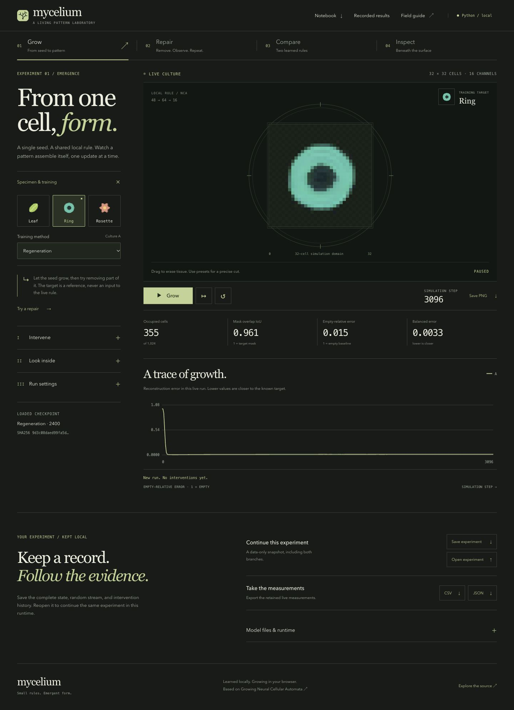

# Mycelium: specimen workbench redesign

The interface now centers the real neural cellular automaton in a specimen workbench. Four numbered experiments organize growth, repair, training-method comparison, and hidden-state inspection. The simulation remains immediately accessible; an attached transport and measurement strip show what is happening. Interventions, inspection, and run settings use progressive disclosure. A separate notebook contains exports and runtime diagnostics, while recorded evaluations have their own evidence ledger.

The existing forest, cream, moss, teal, and amber palette remains. Fine circular specimen marks frame the full square simulation domain without clipping any cells. Large serif headings, plain control typography, and aligned numerical labels establish hierarchy. On mobile, the live culture and playback controls precede secondary setup and tools. Dialogs, loading, extinction, numerical failure, and unavailable-runtime states share the same visual system.

The portfolio benchmark was inspected in the browser and source for execution standards: responsive geometry, complete first paint, focus handling, reduced motion, lifecycle cleanup, and bounded rendering. Its composition, motifs, assets, and animation sequences were not reused. No new dependency, remote inference service, training run, or model was added.

## Visual comparison

Screenshots show actual NumPy/Pyodide states. The initial views use the same ring seed. Workspace/mobile comparisons show mature ring cultures from separate runs; they are equivalent working states, not pixel-identical time steps. Initial comparison: 1280 × 720. Full workspace comparison: 1280 pixels wide. Results comparison: 1440 × 1000. Mobile: 390 × 844. Additional desktop and tablet captures are included below.

| State | Before | After |
| --- | --- | --- |
| Initial seed | [Initial](images/before-initial-1280.jpg) | [Initial](images/after-initial-1280.jpg) |
| Real working culture | [Workspace](images/before-workspace-1280.jpg) | [Workspace](images/after-workspace-1280-full.jpg) |
| Recorded evaluations | [Results](images/before-results-1440.jpg) | [Results](images/after-results-1440.jpg) |
| Narrow mobile | [Mobile](images/before-mobile-390.jpg) | [Mobile](images/after-mobile-390.jpg) |

[Tablet](images/after-tablet-768.jpg) · [Laptop](images/after-workspace-1280.jpg) · [Paired inspection](images/after-paired-1440.jpg) · [Mobile results](images/after-results-390.jpg)

## Verification performed

- 41 native Python tests passed; three JavaScript transport/pointer tests and syntax checks passed.
- Production build validates five trained artifacts and packages 101 files. All manifest hashes and HTTP assets passed at the case-sensitive `/Mycelium/` subpath. The packaged numerical Python source matches the source tree byte-for-byte.
- All 34 original ID-bearing controls remain, all frontend ID references resolve, and no duplicate IDs were introduced. An independent code review checked orchestration and control preservation; its two copy findings were corrected.
- Inspected 1440, 1280, 768, and 390 pixel widths with loaded fonts and no document-level horizontal overflow. Inspected paired layouts on tablet/mobile, results on mobile/desktop, and the field guide on mobile. The results table deliberately scrolls horizontally on narrow screens, with a visible hint and keyboard-focusable region.
- Ran real growth, single step, pause, restart, specimen changes, training comparison, erasure, recovery, total extinction, and explicit reseeding. One damaged ring recovered from 310 occupied cells / 0.844 IoU at step 669 to 356 / 0.958 at step 2598. This is an interaction observation, not a new evaluation claim.
- Inspected RGBA, alpha, hidden-channel, and local-update views. Forked a mature state, damaged branch B, and confirmed A remained unchanged. Zero update probability advanced the step counter without altering the state. Persistent lesions, blocked seed insertion, clearing lesions, and seeded noise worked on B.
- Restored a saved paired experiment at step 3001 with A: 357 occupied cells / 0.955 IoU, B: 276 / 0.728, and unchanged visible/hidden divergence 0.02694 / 0.03761. Imported a saved model and verified worker recreation.
- Downloaded and inspected a 32 × 32 RGBA PNG of culture A, valid measurement CSV/JSON, and a valid model JSON. Experiment export/import and browser parity/benchmark diagnostics also ran. CSV/JSON exports contain retained measurements; complete experiment files contain intervention history.
- Browser parity passed against the frozen reference: maximum one-step difference 5.96e-8 and rollout difference 1.19e-7 (rtol 2e-5, atol 2e-6). The benchmark used an independent clone and left the live experiment unchanged.
- Forced a missing runtime package in an isolated local preview. The error screen disabled simulation controls, kept Reload runtime enabled, and recovered after the asset was restored. Native dialog Escape dismissal restored focus to the opener.

## Scientific and verification limits

The Python engine, worker contract, trained models, targets, frozen evaluation, and numerical semantics are unchanged. Saved results retain failed trials and limitations. A long growth-only comparison stopped as numerically unstable at step 1396; the UI reported the failure. It was not repaired, hidden, or counted as a successful run. Leaf long-term persistence also remains limited, as documented in the original evaluation.

Browser checks used the Codex in-app Chromium browser with responsive viewport overrides. Safari, Firefox, physical touch hardware, and a full screen-reader session were not tested. Reduced-motion rules and autoplay preference handling were inspected in source; the operating-system preference was not changed for a live test. Runtime performance is configuration-specific. This redesign makes no new scientific-quality or performance claim.
