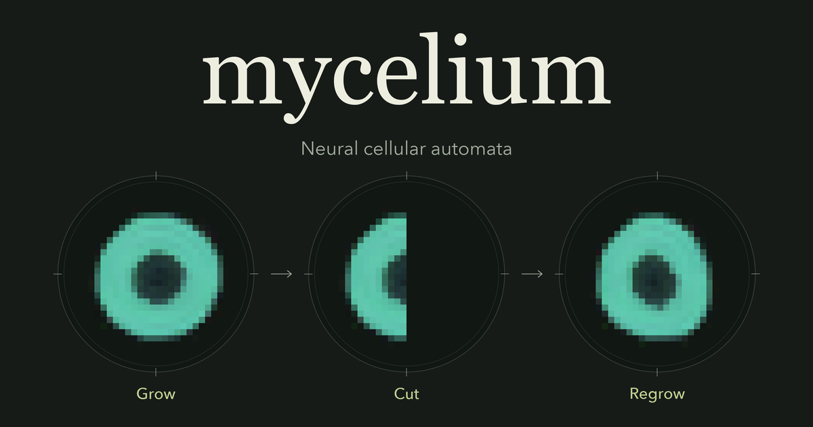

# Mycelium Open Graph artwork



A short visual experiment becomes the identity: one learned ring, its right half erased, and the form that regrows under the same local rule. The large Georgia wordmark, forest ground, cream text, moss labels, Avenir Next descriptor, and fine specimen marks come from Mycelium's current website. The pixel geometry is the actual 32 × 32 automaton, at the same magnification in all three frames. There is no retouching, interpolation of states, fabricated metric, or live-frame selection.

## Regenerate

From the repository root on macOS:

```sh
npm run og
```

This runs `tools/og/render.py`, generates `web/og-v1.png`, regenerates thumbnail/crop proofs, and writes `provenance.json`. It requires the existing Python 3.12 `.venv`, NumPy 2.0.2, and Pillow 11.1.0. A fresh environment can use `.venv/bin/python -m pip install -e '.[artwork]'`; no PyTorch, browser automation, network request, paid service, or GPU is needed to render.

**Editable source:** [render.py](render.py). `final_card` holds the final composition and copy; `COLORS`, `FONTS`, and the `Poster` drawing methods control palette, typography, and specimen geometry. The generated PNG is committed and copied into the production bundle. Social crawlers receive the static file immediately; the application and Python runtime do not need to start.

The export is exactly **1200 × 630**, 8-bit truecolor **RGB**, opaque, with a PNG **sRGB chunk (intent 0)**. Artwork is drawn at 3× resolution and downsampled with Lanczos; native cell pixels are enlarged with nearest-neighbor sampling first, preserving their square geometry. No animation or timestamps enter the export. The current file is **81,174 bytes**. Two consecutive exports were byte-identical in the recorded environment.

### Fonts and licensing

The renderer uses the project's existing Georgia, Georgia Italic, Avenir Next, and Menlo system fonts from the licensed macOS installation. Font files are **not distributed** in this repository. It verifies the exact loaded family/style and records file fingerprints. There is no fallback substitution. `MYCELIUM_OG_SERIF`, `MYCELIUM_OG_ITALIC`, `MYCELIUM_OG_SANS`, and `MYCELIUM_OG_MONO` can point to legitimately installed matching font files/collections at another location. Avenir Next's TTC indices are explicit in the source.

Regeneration is supported with these macOS fonts; Linux CI validates and publishes the committed PNG without requiring them. Different font versions can change text rasterization: compare `provenance.json` before accepting a new export. No third-party image or portfolio asset is included. The scientific artwork is generated from this repository's own trained checkpoint.

## Reproducible specimen

- Checkpoint: `models/ring-regeneration.json`; exact weight hash is in [provenance.json](provenance.json).
- Shared numerical implementation: `mycelium_nca.replay.Simulation` and `numpy_sim.render_rgba`; neither is modified.
- PCG64 seed **123**, update probability **0.5**, 32 × 32 cells, 16 float32 channels.
- **Grow:** 256 steps from the documented single-cell seed.
- **Cut:** erase all 16 channels in the right half at step 256 (`x=16`, `y=0`, width=16, height=32).
- **Regrow:** continue for another 256 steps, to step 512, with the same random stream.
- Occupied cells in these frames: 352 → 168 → 321. This is one illustrative rollout, not a new benchmark or a guarantee of recovery.

The provenance records NumPy/Pillow versions, weights and state hashes, RGBA hashes, font hashes, output hash, and intervention. The numerical engine, models, targets, and evaluation gates are unchanged. Normal export is bounded to 512 CPU simulation steps.

## Studies and refinement

The portfolio's actual [card-v2.png](https://dhanushkrishna4.github.io/card-v2.png), its live metadata, and current repository metadata/build files were inspected as an execution benchmark. Its centered stacked name, signature, contour motif, red/black palette, and font combination were not reused. No editable portfolio card source or dedicated export script was found in its public repository tree.

1. [Single specimen](studies/01-specimen.png): a large culture to the right of an editorial wordmark and explanatory text. Strong identity, but less specific to the product's regenerative behavior.
2. [Regeneration sequence](studies/02-regeneration.png): three observed states with the wordmark along the lower edge. Selected for its immediately legible scientific story.
3. [First polished export](studies/03-first-polished.png): moved the name to the top and simplified the copy. Inspection identified weak, low-positioned phase labels and an imprecise descriptor.
4. Final: larger Avenir phase labels with more bottom margin, understated progression arrows, and the exact subject name, “Neural cellular automata.” No additional feature badges or author URL compete with the sequence.

Regenerate the retained studies with `.venv/bin/python tools/og/render.py --studies`. This does not overwrite the final image or final provenance.

## Inspection and delivery

Visually inspected the exported full-resolution PNG, [600 × 315](proofs/600x315.png), [300 × 158](proofs/300x158.png), a [16:9 center crop](proofs/crop-16x9.png), and a [square center crop](proofs/crop-square.png). The wordmark remains intact in both crop stress tests. A square crop loses the outer stages of the sequence; the intended primary presentation is the complete large-image card. These crops do not claim to represent every platform.

`npm run build` copies only the final image to `dist/og-v1.png`. `.venv/bin/python scripts/verify_build.py` checks initial-HTML metadata, unique OG/Twitter fields, canonical/absolute URLs, PNG chunks/checksums, dimensions, opacity, color declaration, and HTTP image bytes/MIME at `/Mycelium/`. The production manifest also covers the image hash. Metadata follows the [Open Graph specification](https://ogp.me/).

Canonical page: `https://dhanushkrishna4.github.io/Mycelium/`.
Image: `https://dhanushkrishna4.github.io/Mycelium/og-v1.png`.

For future replacements, use a new versioned image name and update the metadata, build copy list, verification expectation, and this documentation together. Do not silently overwrite a published image and assume crawler caches have refreshed.

Website metadata does **not** configure GitHub's repository social-preview setting. This task ships the website card; a separate repository social-preview upload is still needed if that surface should use the same image. No LinkedIn, WhatsApp, or other platform cache refresh is claimed.
